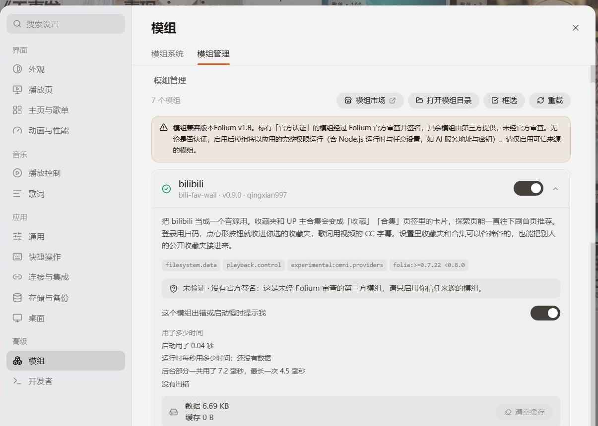
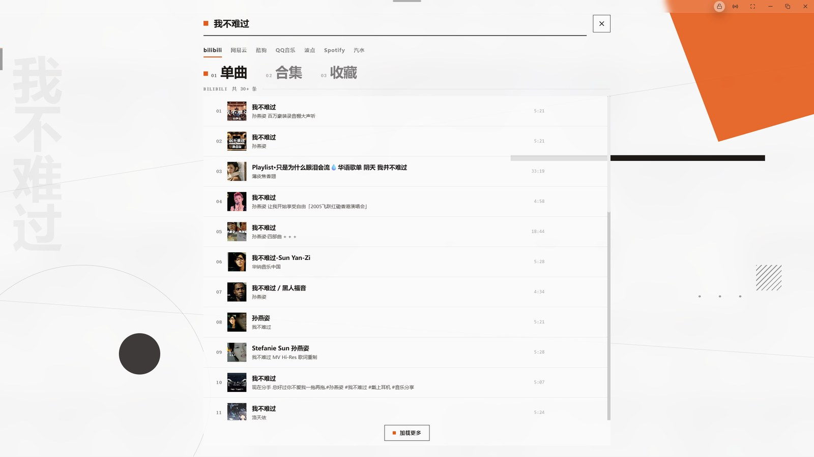
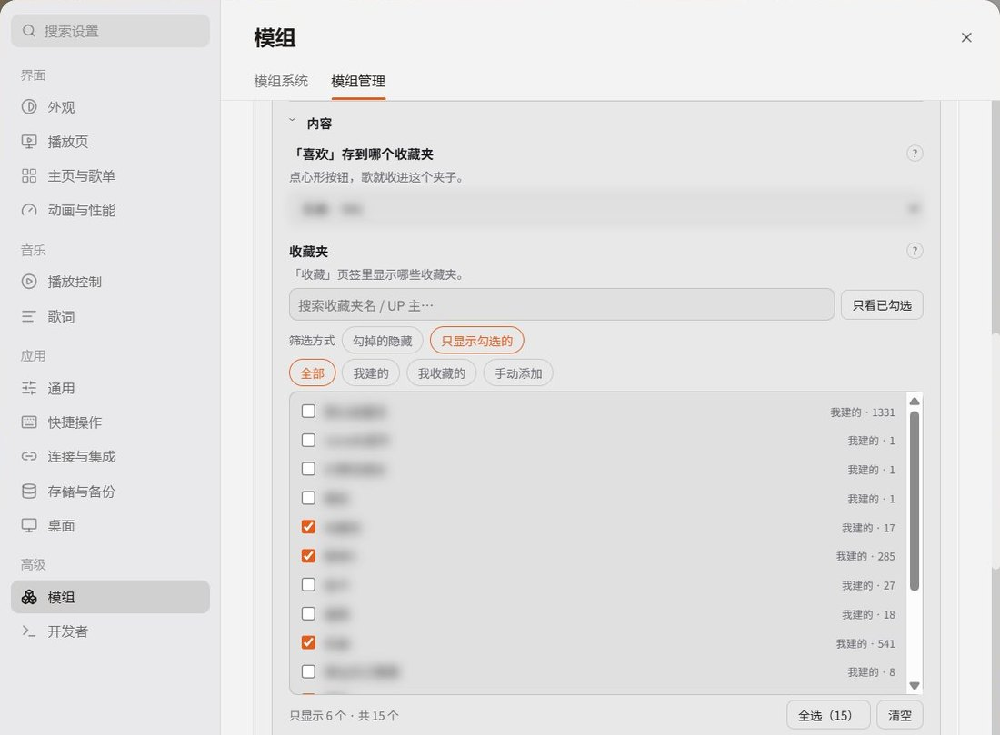
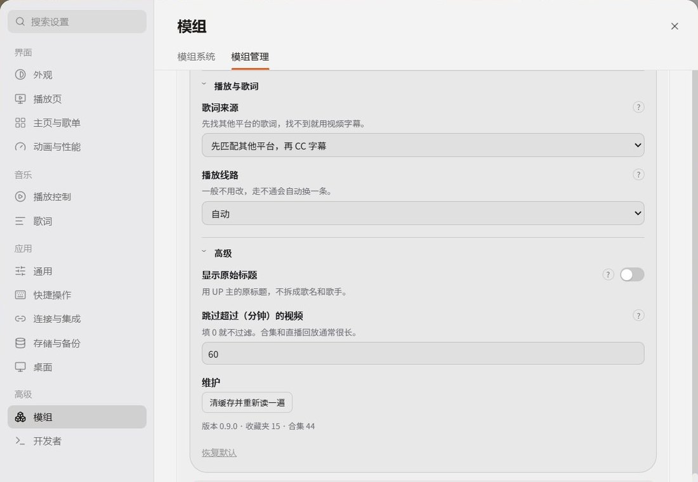

# bilibili for Folia

[](https://github.com/qingxian997/folia-bilibili-source/actions/workflows/ci.yml)

把 bilibili 当成 [Folia](https://github.com/chthollyphile/folia-major) 里的一个普通音源：收藏夹变成「歌单」页签上的卡片，UP 主的合集会出现在「专辑」里，探索页能一直往下刷首页推荐，歌词直接取视频的 CC 字幕。

界面全部由 Folia 自己画，这个模组只提供数据。

> [!WARNING]
> **这是预览版，不是正式版。**
>
> 模组依赖 Folium 的 `omni.providers` 实验接口，而这个接口目前还不完整，官方也不建议拿它做完整音源。所以：
>
> - 宿主每次更新，这里都可能**用不了或者大改**，接口一变就得跟着改；
> - 不保证数据格式、设置项、界面位置稳定；
> - 不会上架官方模组市场（宿主的信任检查会显示「未验证」）；
> - **正式的 1.0 要等 Folium 2（Folia 0.8.0）**，那时接口才谈得上稳定。
>
> 现在能用，能长期自己用，但别拿它当基础设施。

**[下载最新预览版](https://github.com/qingxian997/folia-bilibili-source/releases)** —— 下 `bili-fav-wall-0.9.1.zip`，装法见下面的[快速开始](#快速开始)。源码包在同一个页面。

| | |
| --- | --- |
| 宿主 | Folia 0.7.22 ~ 0.7.x（Folium 1.7 / 1.8） |
| 模组版本 | 0.9.1（预览） |
| 许可证 | MIT |
| 官方市场 | 不上架 |



## 核心特性

- **真·原生音源**：界面、方墙、翻牌、队列、方向键全是 Folia 自己画的，模组只喂数据 —— 所以它长得和别的音源一模一样，不会突然多一层自绘的墙。
- **收藏夹进书库**：我建的、我收藏的、别人的公开收藏夹，都变成书库里的卡片，点开就是歌。
- **合集与系列**：UP 主的合集和系列进「合集」页签，选中 bilibili 时胶囊会自动改名。
- **探索页刷不完**：首页推荐做成一整面瀑布墙，往下滚会一直补，不会停在 96 首。
- **点心形就收藏**：播放器上的心形按钮直接写回 bilibili 的收藏夹，收进哪个夹子由你指定。
- **两种歌词**：优先取视频自带的 CC 字幕，没有就按标题去别的平台匹配；顺序可调，也可以全关。
- **能筛选**：收藏夹和合集各管各的，黑名单 / 白名单两种玩法，也支持长视频自动跳过。

| 你想干的 | 在哪里 |
| --- | --- |
| 搜全站视频、播放 | 音源切到 bilibili，用宿主的搜索 |
| 我建的 / 我收藏的收藏夹 | 书库 →「歌单」页签，一格一个夹子 |
| 别人的公开收藏夹 | 设置里贴链接，进「歌单」页签 |
| UP 主合集、系列 | 设置里贴链接，进「专辑」页签（选中 bilibili 时叫「合集」） |
| 首页推荐（无限刷） | 书库 →「探索」页签，往下滚滚不完 |
| 点心形收进收藏夹 | 播放器上的心形按钮，收进你指定的那个夹子 |
| 歌词 | 视频自带的中文字幕，或者按标题去别的平台匹配 |

## 截图

播放器页：封面、逐行歌词、音质标签都来自 bilibili 那个视频。下面这段是录的实机，歌词会跟着唱。


搜索页：搜的是 bilibili 全站视频，标题会顺手洗成「歌名 / 歌手」。除了「单曲」「合集」，还多一个「收藏」页签，能在自己的收藏夹里搜。



收藏页：一个收藏夹点开就是一整面封面墙，失效视频会被跳过，不占位。


## 快速开始

### 安装

1. 在 [Releases](https://github.com/qingxian997/folia-bilibili-source/releases) 下载 `bili-fav-wall-0.9.1.zip`。
2. 解压到 Folia 的模组目录，文件夹名叫 `bili-fav-wall`：

   ```
   %APPDATA%\Folia\mods\bili-fav-wall\mod.json
   ```

   （macOS / Linux 是 Electron 的 userData 目录，即 `…/Folia/mods/`。）

3. **完全退出 Folia 再启动** —— 只关窗口不算，模组只在启动时加载。
4. 设置 → 模组 → 模组管理 → 找到 bilibili → 打开开关。
   第一次会问你是否信任：这个模组没有官方签名，选「信任」才会加载。
5. 书库首页 → 音源 → bilibili → 扫码登录。

装好之后，模组卡片上会显示版本号、启动耗时和缓存占用；有异常时那行会写出来。

### 第一次用

**登录**：设置 → 模组 → bilibili →「账号」→ 扫码登录。二维码直接画在设置面板里，用 bilibili App 扫一下，手机上确认，回到 Folia 就登录好了。
凭据由 Folia 加密保存在本机，模组只读不写，也不会发到任何服务器。

**看收藏夹**：书库 →「歌单」。默认收藏夹、「我喜欢的音乐」、你自己建的、以及设置里贴进来的公开收藏夹，都在这一页。

**刷推荐**：书库 →「探索」。一直往下滚就行，滚到宿主的自动读取停下之后，模组会接着补。

**收藏一首歌**：播放器上的心形。收进哪个夹子由设置里「「喜欢」存到哪个收藏夹」决定，默认是你的默认收藏夹。

**歌词**：优先取视频的 CC 字幕；没有字幕时按标题去网易云、QQ 音乐那边找同名的。两种都可以在设置里关掉。

## 设置项

设置面板有四组，**默认全部收起来**，标题右边写一句当前状态，一眼能看出改成什么样了。


（截图里账号那行的摘要打了码，实际是你的昵称。）

**账号**

| 项 | 说明 |
| --- | --- |
| 登录状态 / 扫码登录 / 退出登录 | 登录后才能读收藏夹、合集和「我喜欢的音乐」 |

**内容** —— 决定墙上出现什么

| 项 | 说明 |
| --- | --- |
| 「喜欢」存到哪个收藏夹 | 点心形时收进哪个夹子 |
| 收藏夹 | 搜索、按来源筛（我建的 / 我收藏的 / 手动添加）、勾选。每张表自带「勾掉的隐藏」和「只显示勾选的」两种方式，各记一份 |
| 合集 | 同上，和收藏夹各管各的 |
| 额外列表 | 贴一条公开收藏夹 / 合集 / 系列的链接，就多一个卡片，能随时删 |



名字打了码，实际会显示收藏夹名和条目数。

**播放与歌词**

| 项 | 说明 |
| --- | --- |
| 歌词来源 | 先匹配其他平台再 CC 字幕 / 反过来 / 只用一种 / 不要歌词 |
| 播放线路 | 直连还是走本机中转。一般不用改，一条走不通会自动换 |

**高级**

| 项 | 说明 |
| --- | --- |
| 跳过超过多少分钟的视频 | 合集和直播回放通常很长，填 0 就不过滤 |
| 显示原始标题 | 列表和播放器显示 UP 主原题，不用「歌手 - 歌名」 |
| 清缓存并重新读一遍 | 数据不对时点这个 |



每组标题右边的「?」里写的是这一项什么时候该动，平时不用看。

## 已知限制

- **依赖实验接口**：宿主更新后可能整块失效，等适配。
- **搜索给的是视频**，不是音乐。所以标题会带「【】」「4K」「MV」这类字样，模组会尽量洗干净，但洗不干净的情况有。
- **探索页只有 bilibili 首页推荐**，没有「每日推荐」「私人 FM」这类东西 —— 那些接口没有。
- **心形按钮只对纯数字 id 的自建收藏夹生效**，公开收藏夹是只读的。
- **封面靠猜**：bilibili 的收藏夹接口不返回封面，模组拿夹子里第一条视频的封面顶上，所以有的夹子封面会和内容不完全对。
- **会被限流**：短时间内反复刷墙、连续狂滚探索页，可能触发 bilibili 的 412，表现为转圈或空白。停下来等几分钟就好，不是坏了。
- **只支持 Windows 上验证过的 Folia**，其它平台没测。

## 常见问题

**装好后设置里找不到模组？**
看 `%APPDATA%\Folia\mods\bili-fav-wall\mod.json` 在不在。多套一层文件夹也可以，但 `mod.json` 必须在 `bili-fav-wall` 或者它下面唯一那层子文件夹里。

**模组卡片红字报错？**
那是 `mod.json` 校验没过，多半是改过文件或版本对不上，重新解压一份。

**墙上没有卡片？**
先看有没有登录；再看设置里「内容」两张表是不是把所有夹子都勾掉了（白名单空着会显示全部，黑名单空着也是全部）。

**一直转圈 / 空白？**
可能被限流了。等几分钟，或者去设置里「清缓存并重新读一遍」。

**歌放不出声？**
把「播放线路」改成另一个再试。有些地区直连 CDN 不通。

**没有歌词？**
视频本来就没字幕，而且没匹配到别的平台。这就是正常结果，不是 bug。

## 参与贡献

欢迎提 [Issue](https://github.com/qingxian997/folia-bilibili-source/issues) 和 PR。看过下面几条再来，能省掉好几轮来回。

**报 Bug**：用 Bug 模板，写清三件事 —— **宿主版本**（设置 → 关于）、**复现步骤**（第几步出现、点了什么）、**你期待什么**。截图比描述快，控制台的报错比截图快。缺这几样的话，我大概率只能回一句「麻烦补一下」，然后这个 issue 就一直挂在那。

**提需求之前**：先翻一眼 [已知限制](#已知限制)。「要会员才能听的」不是 bug，「全站收藏夹搜索」这条 bilibili 自己没有接口 —— 这类需求大概率不会做，但你可以先问。

**提 PR**：一个 PR 只做一件事，并且在正文里写 `Closes #123` 关联对应的 Issue。没关联 Issue 的大改动我会先问清楚再合并，否则很容易白写。跑过 `npm test` 是底线，CI 也会跑。

**标签怎么用**：

| 标签 | 意思 |
| --- | --- |
| `bug` | 确认是坏了 |
| `enhancement` | 想做但还没做的新东西 |
| `good first issue` | 小而独立、有明确改法，第一次参与就从这里挑 |
| `help wanted` | 我这边做不了（没设备、没账号、没那家平台的接口），需要人接 |
| `host-update` | 换宿主版本之后才坏的，多半是宿主改了东西 |
| `upstream` | 卡在 bilibili 或宿主那边，改不了，只能等 |
| `needs-info` | 缺关键信息，等提问人补 |
| `login` | 扫码、Cookie、掉号这一类 |

**Review**：我会尽快回。就算不合并，也会写清楚为什么不合并 —— 要么方向不对、要么范围太大、要么宿主接口不给条件。这不是否定你写的东西。

完整流程、代码约定和提交格式见 [CONTRIBUTING.md](CONTRIBUTING.md)。参与讨论即视为遵守 [行为准则](CODE_OF_CONDUCT.md)。

## 卸载

设置 → 模组 → 关掉开关，然后删掉 `%APPDATA%\Folia\mods\bili-fav-wall` 整个文件夹。
登录凭据存在 Folia 自己的加密存储里，卸载模组不会自动清掉，需要的话在模组里先点「退出登录」。

## 免责声明

- 这不是 bilibili 官方项目，和 bilibili 没有任何关系，也没有得到官方授权。
- 这个模组只做「把公开数据整理成 Folia 认识的形状」：搜索、读收藏夹、播视频自带的声音、取视频自带的字幕。**不提供下载，不破解付费或会员内容**，能不能播取决于你的账号和 bilibili 自己的规则。
- 登录凭据只存在本机，由 Folia 加密保管，模组不上传任何数据。但仍然要提醒：**用第三方客户端访问账号，风险由你自己承担**。
- 请遵守 bilibili 的用户协议和当地法律。如果官方提出异议，这个项目会随时停止维护或删除仓库。

---

# 给开发者

改动之前先读 [docs/HOST-CONTRACT.md](docs/HOST-CONTRACT.md)：那里面写了宿主的契约、踩过的坑、以及为什么有些写法不能动。

## 目录

```
mod.json              清单：id / 版本 / 入口 / 权限 / 宿主版本范围
index.cjs             主进程：所有 bilibili 请求、Cookie、音频中转
client.mjs            渲染进程：provider、曲库、探索、歌词、音质
lib/                  两边共用的小模块（纯函数优先）
vendor/qrcode.mjs     扫码用的二维码生成（MIT，附许可证）
test/                 node:test 单测，不需要 Folia 就能跑
docs/                 CHANGELOG、宿主契约、截图
```

`client.mjs` 里只剩接线：设置面板本体在 `lib/settingsPanel.mjs`（约 950 行，只认 `deps` 传进来的依赖）。

## 跑测试

```bash
npm install       # 只装 jsdom，测试用（需要 Node 22.19 以上）
npm test          # 251 个用例
npm run check     # 校验 mod.json（字段白名单、权限、版本一致性）
```

测试不用 Folia，也不联网：所有 RPC 和 DOM 都是桩。当前 251 个用例（248 通过 / 3 跳过）。

## 打包

```bash
python scripts/pack.py          # 版本号读 mod.json
python scripts/pack.py 0.9.1    # 临时用别的版本号
```

产物在 `dist/`：`bili-fav-wall-0.9.1.zip`（只含运行需要的文件，解压即用）和 `-source.zip`（多带 `test/`、`docs/`、`scripts/`）。
zip 条目必须是正斜杠，脚本会自己校验；`mod.json` 必须在根目录；两个包的 sha256 会打在输出里，贴进 Release 说明即可。

## 宿主契约（要点）

- **`mod.json` 的字段是白名单**：只允许 `folium / id / name / version / author / description / main / client / depends / permissions / experimental / embedOrigins / folia / preview`。写别的（比如 `homepage`、`repository`）在 Folium 2 里会直接报错。
- **`version` 必须三段数字**（`0.9.0`），`0.9.0-preview` 会校验失败。预览状态只能靠 GitHub 的 pre-release 和 README 表达。
- **权限要真的用**：`filesystem.data`（存 Cookie 和缓存）、`playback.control`（放歌）。少一个会被门禁拦，多一个只是让用户在信任弹窗里多看一眼，所以别乱写。
- **`experimental: ["omni.providers"]`** 是音源注册的入口，也是这个模组最脆弱的地方。
- **`folia` 范围**：`>=0.7.22 <0.8.0`。0.8.0 就是 Folium 2，到那时要重新适配、重新发一个正式版。

细节、踩坑和反例在 [docs/HOST-CONTRACT.md](docs/HOST-CONTRACT.md)。

## 跟着宿主升级

宿主每次改版，前端 chunk 的哈希会变，内部函数名也会变。升级后按这个顺序过一遍：

1. 用 asar 扫描脚本确认用到的 DOM 选择器和 store 还在（`data-bravais-tab`、`lattice-field`、`loadMoreOf`）。
2. 装一份新宿主，开 `--remote-debugging-port=9222`，用 CDP 打开设置面板核对字段，看有没有红字报错。
3. 真机走一遍：收藏页 / 专辑页 / 探索页 / 播放 / 歌词 / 扫码。
4. 改完重新打包，写 CHANGELOG。

改过的文件会改变目录摘要，宿主的信任记录会失效并显示「需要重新确认」，这是正常的。

## 发版

1. 改 `mod.json` 的 `version` 和 `client.mjs` 里的 `MOD_VERSION`（两处必须一致）。
2. 在 `docs/CHANGELOG.md` 顶部加一段。
3. `npm test` 全绿。
4. 打包，算 SHA256，附在 Release 说明里。
5. GitHub Release 勾上 **pre-release**（在 1.0 之前一直如此）。

## 代码约定

- 文案面向普通用户：一条只说「动了会怎样」「什么时候该动」，不写接口路径、不写进程名。
- 新逻辑优先写成 `lib/` 里的纯函数，带单测；`client.mjs` 只留接线。
- 所有延迟执行走 `later()`，停用时要能一把清掉；定时器和监听器都要有对应的清理。
- 缓存必须有上限。主进程的短期记忆见 `lib/memoCache.cjs`，客户端各张表都在写入处裁剪。

## 许可证

[MIT](LICENSE)。内置的二维码生成来自 [qrcode](https://github.com/soldair/node-qrcode)，同样是 MIT。
