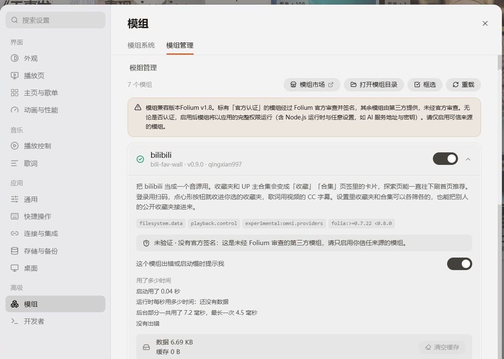
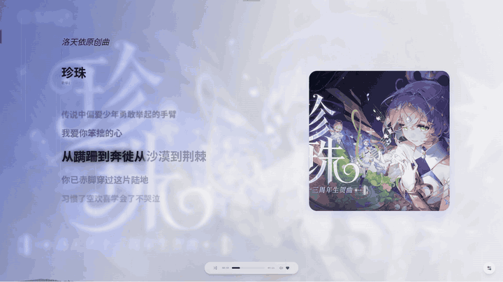
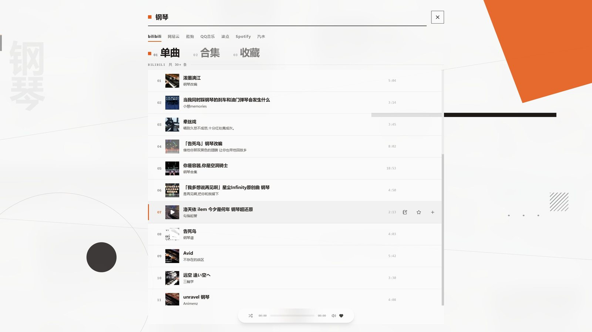
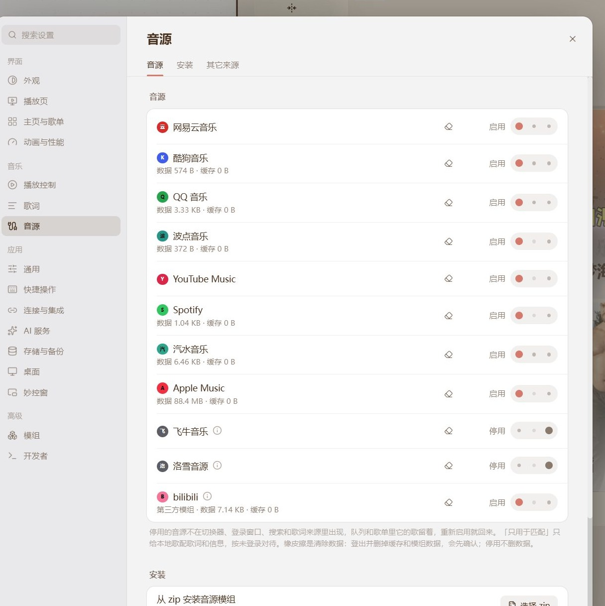
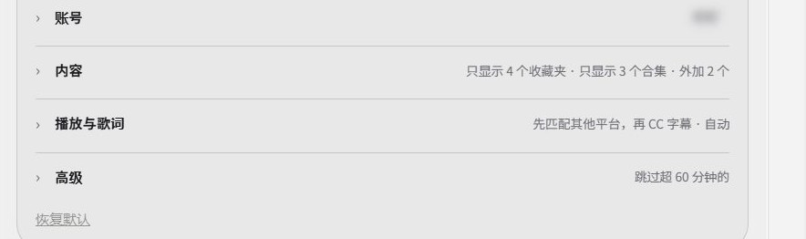
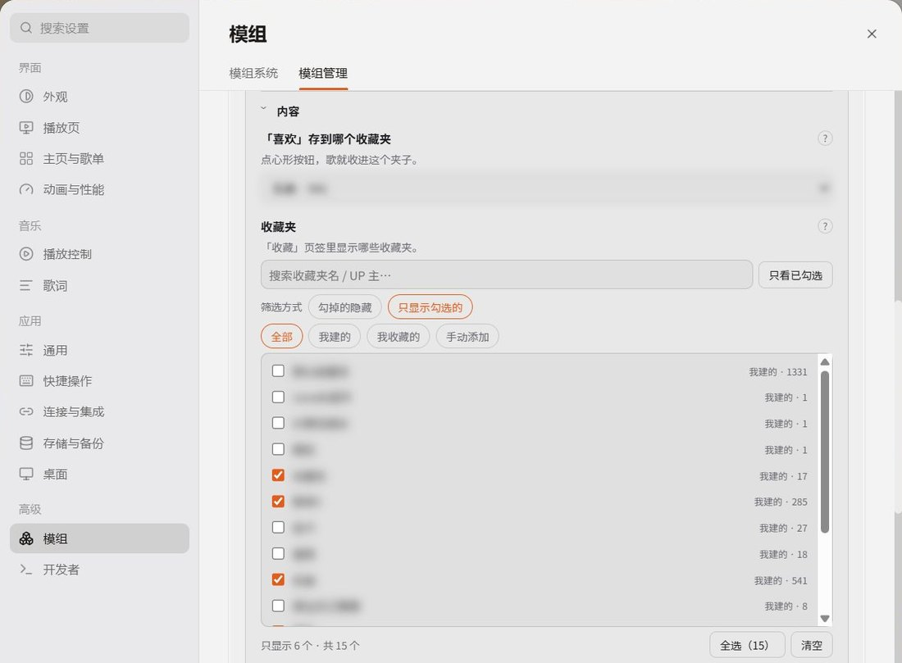
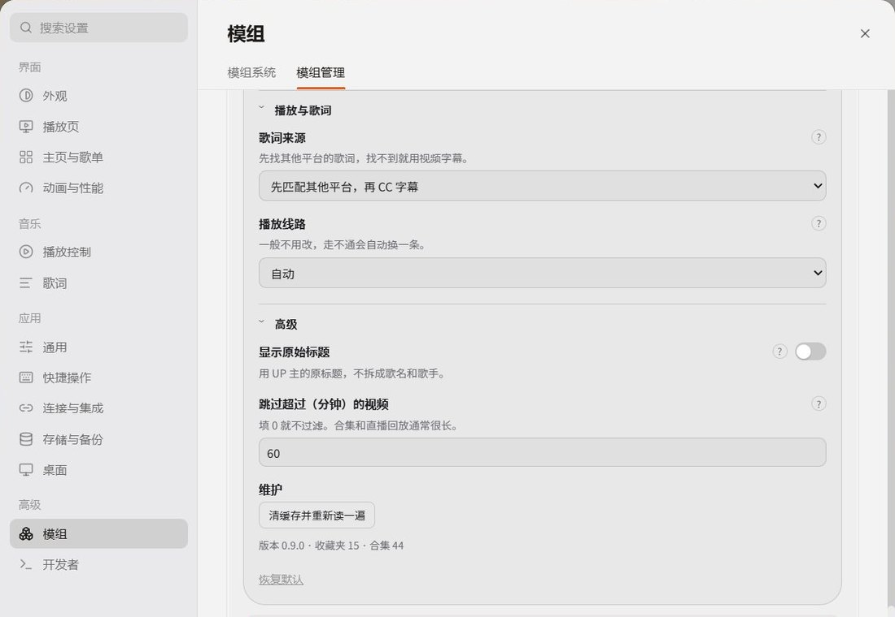

# bilibili for Folia

把 bilibili 当成 [Folia](https://github.com/chthollyphile/folia-major) 里的一个音源：搜视频、听收藏夹与 UP 主合集、用视频字幕当歌词。

> [!NOTE]
> **bilibili 音源**：把公开视频的声音、字幕和曲库信息整理成 Folia 认识的形状，沿用 Folia 的搜索、书库、播放器和歌词界面。

> [!WARNING]
> **2.0.3 正式版：Folium 2 原生音源。**
>
> 模组已按 `folium: 2` 的 `sources` 契约声明能力，不再借实验接口。正式版指的是功能完整、可直接安装使用；未经过社区审核与签名前，它仍是「未验证」的社区模组，需要开启「社区模组」开关才能安装运行。

2.0.3 的变化见[更新报告](docs/RELEASE-2.0.3.md)。安装包在仓库 Releases，下载方法见下面的[快速开始](#快速开始)。

| | |
| --- | --- |
| 宿主 | Folia 0.8.x（模组系统 0.2.0 / Folium 2）；**本版本针对 Folia 0.8.0 验证** |
| 模组版本 | 2.0.3（原生音源） |
| 许可证 | MIT |

## 核心特性

- **收藏夹进书库**：我建的、我收藏的、别人的公开收藏夹，都变成书库里的卡片，点开就是歌。
- **合集与系列**：UP 主的合集和系列进「合集」页签，选中 bilibili 时胶囊会自动改名。
- **分 P 按 P 播放**：搜索、收藏夹、合集里多 P 视频会按每一 P 列出；探索页一个视频只显示 P1。
- **探索页用宿主原生体验**：首页推荐做成一整面瀑布墙，往下滚由宿主翻页，点「换一批」换一批推荐（会避开你最近听过的）。
- **点心形就收藏**：播放器上的心形按钮直接写回 bilibili 的收藏夹，收进哪个夹子由你指定；分 P 也能记住喜欢状态。
- **两种歌词**：优先取视频自带的 CC 字幕，没有就按标题去别的平台匹配；顺序可调，也可以全关。「匹配歌词」窗口里有 bilibili 页签。
- **音质按实际显示**：宿主通名会换成 64K、132K、192K、FLAC 这类 bilibili 实际档位。
- **能筛选**：收藏夹和合集各管各的，黑名单 / 白名单两种玩法，也支持长视频自动跳过。

| 你想干的 | 在哪里 |
| --- | --- |
| 搜全站视频、播放 | 音源切到 bilibili，用宿主的搜索 |
| 我建的 / 我收藏的收藏夹 | 书库 →「歌单」页签，一格一个夹子 |
| 别人的公开收藏夹 | 设置里贴链接，进「歌单」页签 |
| UP 主合集、系列 | 设置里贴链接，进「专辑」页签（选中 bilibili 时叫「合集」） |
| 首页推荐 | 书库 →「探索」页签，往下滚翻页，点「换一批」换一批 |
| 点心形收进收藏夹 | 播放器上的心形按钮，收进你指定的那个夹子 |
| 歌词 | 视频自带的中文字幕，或者按标题去别的平台匹配；「匹配歌词」窗口里选 bilibili 页签只看 CC 字幕 |
| 分 P 视频 | 搜索、收藏夹、合集里按每一 P 列出；探索页只显示 P1 |

## 截图

播放器页：封面、逐行歌词、音质标签都来自 bilibili 那个视频。下面这段是录的实机，歌词会跟着唱。

搜索页：搜的是 bilibili 全站视频，标题会顺手洗成「歌名 / 歌手」。除了「单曲」「合集」，还多一个「收藏」页签，能在自己的收藏夹里搜。

收藏页：一个收藏夹点开就是一整面封面墙，失效视频会被跳过，不占位。

设置页：bilibili 和其他音源一样列在「设置 → 音源」里，可以单独停用或清数据。模组自己的设置藏在这个音源的详情里。

## 快速开始

### 安装

1. 从 [Releases](https://github.com/qingxian997/folia-bilibili-source/releases) 下载 `bilibili-2.0.3.zip`。
2. **完全退出 Folia**，只关窗口不算。
3. 解压到 `%APPDATA%\Folia\mods\bilibili\`，`mod.json` 要在这一层。
4. 启动 Folia，在「设置 → 模组 → 模组管理」打开 bilibili，确认信任后加载。
5. 书库首页 → 音源 → bilibili → 扫码登录。

从旧版升级时覆盖旧目录里的文件，登录凭据和设置会保留；确认信任后按提示重启。

装好之后，模组卡片上会显示版本号、启动耗时和缓存占用；有异常时那行会写出来。

### 第一次用

**登录**：设置 → 模组 → bilibili →「账号」→ 扫码登录。二维码直接画在设置面板里，用 bilibili App 扫一下，手机上确认，回到 Folia 就登录好了。也可以点音源列表里的 bilibili，打开 Folia 的统一登录面板。
凭据由 Folia 加密保存在本机，模组只读不写，也不会发到任何服务器。账号名旁出现会员图标时，表示当前 bilibili 账号是大会员。

**看收藏夹**：书库 →「歌单」。默认收藏夹、「我喜欢的音乐」、你自己建的、以及设置里贴进来的公开收藏夹，都在这一页。

**刷推荐**：书库 →「探索」。一直往下滚，由宿主继续读取；点「换一批」会换一组推荐。

**收藏一首歌**：播放器上的心形。收进哪个夹子由设置里「「喜欢」存到哪个收藏夹」决定，默认是你的默认收藏夹。

**歌词**：优先取视频的 CC 字幕；没有字幕时按标题去网易云、QQ 音乐那边找同名的。两种都可以在设置里关掉。

## 设置项

设置面板有四组，**默认全部收起来**，标题右边写一句当前状态，一眼能看出改成什么样了。

**账号**

| 项 | 说明 |
| --- | --- |
| 登录状态 / 扫码登录 / 退出登录 | 登录后才能读收藏夹、合集和「我喜欢的音乐」 |

**内容** —— 决定墙上出现什么

| 项 | 说明 |
| --- | --- |
| 「喜欢」存到哪个收藏夹 | 点心形时收进哪个夹子 |
| 收藏夹 | 搜索、按来源筛（我建的 / 我收藏的 / 手动添加）、勾选。每张表自带「勾掉的隐藏」和「只显示勾选的」两种方式，各记一份 |
| 合集 | 同上，和收藏夹各管各的 |
| 额外列表 | 贴一条公开收藏夹 / 合集 / 系列的链接，就多一个卡片，能随时删 |

名字打了码，实际会显示收藏夹名和条目数。

**播放与歌词**

| 项 | 说明 |
| --- | --- |
| 歌词来源 | 先匹配其他平台再 CC 字幕 / 反过来 / 只用一种 / 不要歌词 |
| 播放线路 | 直连还是走本机中转。一般不用改，一条走不通会自动换 |

**高级**

| 项 | 说明 |
| --- | --- |
| 跳过超过多少分钟的视频 | 合集和直播回放通常很长，填 0 就不过滤 |
| 显示原始标题 | 列表和播放器显示 UP 主原题，不用「歌手 - 歌名」 |
| 自动更新 | 打开后启动时检查 GitHub 上的新版本，下载校验通过后交给 Folia 安装；安装时仍要确认信任，有时要重启 |
| 检查更新 / 下载并安装 | 手动查版本、下载并安装更新包 |
| 清缓存并重新读一遍 | 数据不对时点这个 |

每组标题右边的「?」里写的是这一项什么时候该动，平时不用看。

## 反馈

问题和建议直接发到 [Issues](https://github.com/qingxian997/folia-bilibili-source/issues)。报问题前先看一眼 [已知限制](docs/LIMITATIONS.md) 和 [常见问题](docs/FAQ.md)，带上宿主版本和复现步骤就好。

---

[许可证](LICENSE)：MIT。
